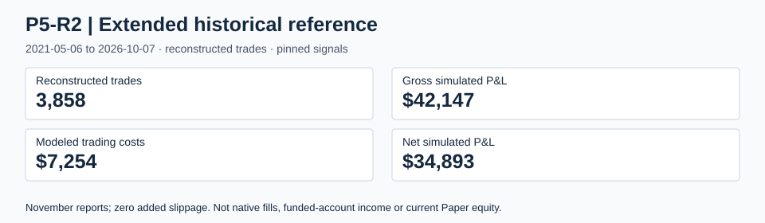
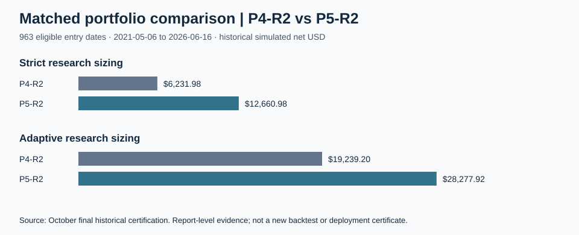
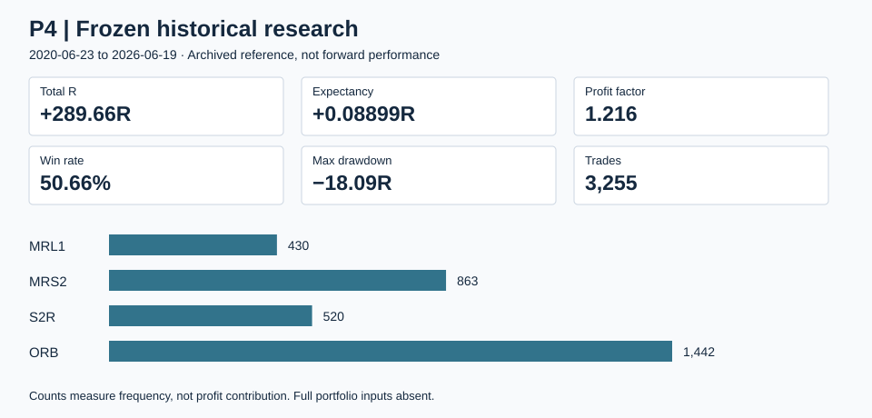
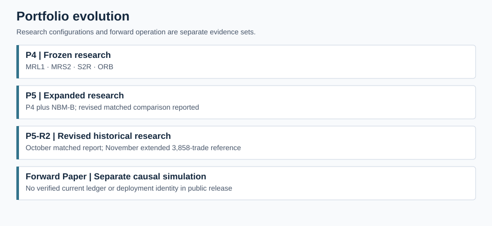
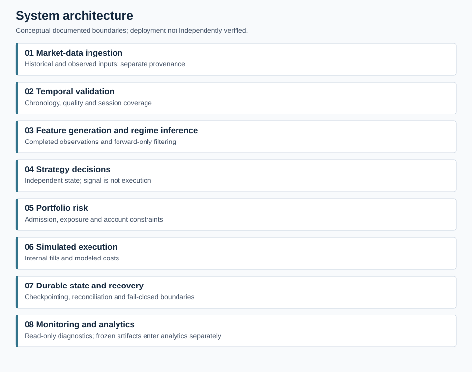

# DÉDALO I | Systematic Futures Research

[](https://github.com/santiago-pascual/DEDALO-I/actions/workflows/ci.yml)

**Quantitative research · Causal inference · Simulated execution · Risk engineering**

DÉDALO I is my independent research project investigating systematic intraday trading on Micro E-mini Nasdaq-100 futures (MNQ). It explores how statistical signals can be translated into a portfolio of complementary strategies, and how historical research can be separated from causal inference, realistic simulated execution and robust operational monitoring.

This repository is a **public research showcase**, not the operational trading system. It contains selected aggregate findings, methodology, architecture and a standalone synthetic-data demonstration. The private implementation is not distributed. The project uses AI-assisted research and software development; no claim of entirely independent implementation is made.

## Central research questions

- Can complementary intraday strategies improve risk-adjusted outcomes under matched evaluation?
- Can causal regime inference and simulated execution retain historical evidence without future information?
- Can economic outcomes withstand execution costs, funding constraints and adverse conditions?

**Research status:** five-strategy P5-R2 historical reference and matched October certification recovered; native integration remains blocked. Full independent causal reproduction and economic feasibility remain incomplete. CI covers the public showcase only.

## Final historical research portfolio — P5-R2

P5-R2 combines MRL1, MRS2, S2R, ORB and NBM-B. The November 24 extended historical reference (2021-05-06 to 2026-10-07) reports **3,858 reconstructed trades, $42,147 gross simulated P&L, $7,254 modeled trading costs and $34,893 net**. The November accounting report corroborates the aggregate; this showcase does not independently reproduce the pinned signals or original fills. It is a historical reference, not funded-account income or current Paper performance.



### Matched incremental contribution

The October 28 historical certification compares P4-R2 and P5-R2 on 963 identical eligible entry dates (2021-05-06 to 2026-06-16), with a shared accounting clock through 2026-06-22.

| Matched research convention | P4-R2 net USD | P5-R2 net USD | Increment |
|---|---:|---:|---:|
| Strict sizing | 6,231.98 | 12,660.98 | +6,429.00 |
| Adaptive sizing | 19,239.20 | 28,277.92 | +9,038.72 |



The adaptive comparison reports daily P&L Sharpe of 1.206 versus 1.560. Paired bootstrap intervals are positive under the tested assumptions, but sufficiently adverse execution stress can turn absolute P&L negative even when the incremental comparison remains favorable. The source reports 64 execution-stress cases and 112 passing historical validation tests. These checks were not rerun here. Its final classification remains **INTEGRATION_BLOCKED**; the revised portfolio's deployment is not certified.

See [full portfolio evolution and matched statistics](docs/portfolio_evolution.md) and [NBM-B methodology, literature and robustness](docs/nbm_research.md).

## Original P4 research baseline

| Frozen historical portfolio (P4) | Archived reference |
|---|---:|
| Evaluation window | 2020-06-23 – 2026-06-19 |
| Trades | 3,255 |
| Cumulative net risk multiples | +289.66R |
| Expectancy | +0.08899R/trade |
| Profit factor | 1.216 |
| Win rate | 50.66% |
| Maximum drawdown | −18.09R |

These are archived research reference values, not newly reproduced portfolio results or live returns. The source ZIP did not contain all frozen inputs required to reproduce the entire portfolio. R is a risk-normalized research unit, not account dollars. No annualized account return is implied.



One component, S2R, was independently reconciled from a stored historical outcome artifact: 520 included trades, +26.932R, 1.117 profit factor and 45.96% win rate. This verifies aggregation of recorded outcomes, not the original signal or fill generation.

## Research evolution



- P4 combines long and short mean reversion, a short regime strategy and an opening-range breakout.
- P5 expands the research portfolio with NBM-B; P5-R2 is the revised historical research configuration, compared against P4-R2 in the recovered October certification. The extended November reference is separate from that matched comparison. Underlying private tapes and current deployment proof are not included.
- Causal forward operation is deliberately distinguished from frozen historical research, especially where hidden Markov model fitting and decoding differ.
- Funded-account constraint research explores the effect of transaction costs, fees, path dependence and payout rules. The archived economic study does **not** support real-money commitment on the available evidence.

## Engineering architecture



The private project documentation describes chronological data admission, completed-observation inference, simulated orders and fills, durable delivery, checkpoint recovery and read-only analytics. This is a high-level representation of documented capabilities, not a claim that every component is deployed or independently certified. No broker execution interfaces, production configurations or account records are distributed.

## Economic feasibility research


The archived broad validation used 20,000 shared bootstrap paths and 16 locked policies. A separate matched execution-cost stress reported a 17.9% decline in net P&L. Reconstructed inputs and conditional historical holiday-close rules limit interpretation; a date-aware overlay passed conditional structural checks, not native or historical-rule certification. The available evidence does not support real-money commitment. See the [economic research](docs/economic_research.md) for the scope and limitations.

## Research methodology and limitations

The key methodological distinction is between **artifact reconciliation**, **historical execution replay**, and **end-to-end causal validation**. Agreement at one level does not establish the next. See the [research evidence](docs/research_evidence.md), [architecture](docs/architecture.md), [economic research](docs/economic_research.md) and [limitations](docs/limitations.md).


## Reproducible demonstration

The standalone standard-library Python example calculates risk-multiple statistics on explicitly synthetic outcomes. It includes an initial-zero drawdown convention, loss-free handling and tests. It does not import the trading system, generate signals, fetch market data or replicate the archived returns.

```sh
python examples/risk_metrics.py
python -B -m unittest discover -s tests -v
python -B scripts/validate_publication.py
python -B scripts/generate_figures.py --check
```

## Documentation index

- [Portfolio evolution](docs/portfolio_evolution.md) · [NBM-B research](docs/nbm_research.md) · [Evidence index](docs/research_evidence.md)
- [Architecture](docs/architecture.md) · [Economic feasibility](docs/economic_research.md)
- [Reproducibility](docs/reproducibility.md) · [Scientific limitations](docs/limitations.md)
- [Research paper evidence plan](docs/research_paper_index.md) · [Citation metadata](CITATION.cff)

No approved dashboard screenshots are available; no simulated screenshots are presented.

## Author and publication scope

Santiago Pascual — independent quantitative research project. Public documentation and demonstration only; no institutional affiliation, live performance, funded qualification or production readiness is claimed. Raw market data and proprietary strategy implementation are excluded. No permission to redistribute third-party data or private code is granted. See [publication manifest](PUBLICATION_MANIFEST.md).
