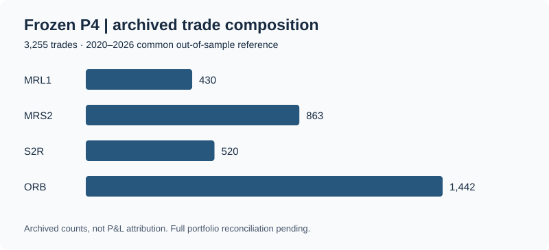
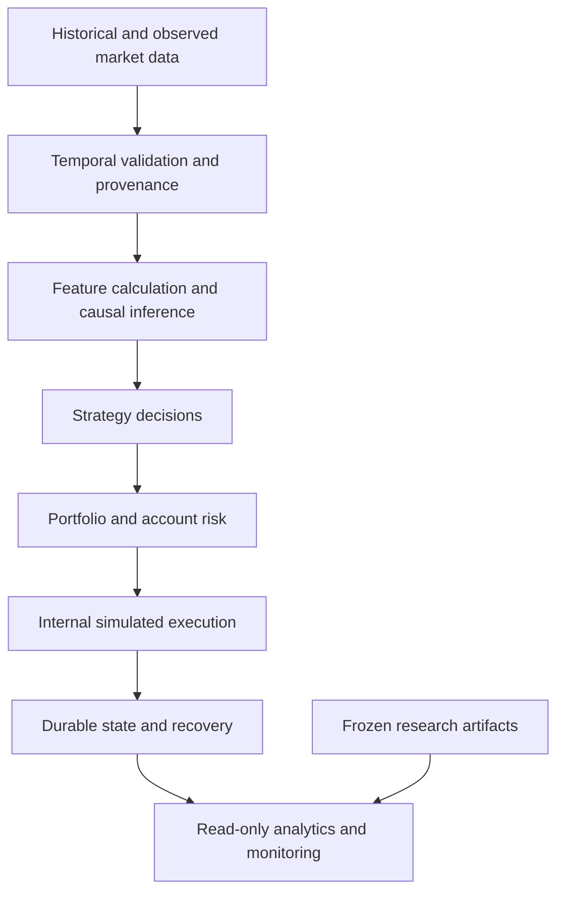

# DÉDALO I | Systematic Futures Research

**Quantitative research · Causal inference · Simulated execution · Risk engineering**

DÉDALO I is my independent research project investigating systematic intraday trading on Micro E-mini Nasdaq-100 futures (MNQ). It explores how statistical signals can be translated into a portfolio of complementary strategies, and how historical research can be separated from causal inference, realistic simulated execution and robust operational monitoring.

This repository is a **public research showcase**, not the operational trading system. It contains selected aggregate findings, methodology, architecture and a standalone synthetic-data demonstration. The private implementation is not distributed. The project uses AI-assisted research and software development; no claim of entirely independent implementation is made.

## Selected research evidence

| Frozen historical portfolio (P4) | Archived reference |
|---|---:|
| Evaluation window | 2020-06-23 – 2026-06-19 |
| Trades | 3,255 |
| Cumulative net risk multiples | +289.66R |
| Expectancy | +0.08899R/trade |
| Profit factor | 1.216 |
| Win rate | 50.66% |
| Maximum drawdown | −18.09R |

These are archived research reference values, not newly reproduced portfolio results or live returns. The source ZIP did not contain all frozen inputs required to reproduce the entire portfolio. R is a risk-normalized research unit, not account dollars. No annualized account return is implied.



One component, S2R, was independently reconciled from a stored historical outcome artifact: 520 included trades, +26.932R, 1.117 profit factor and 45.96% win rate. This verifies aggregation of recorded outcomes, not the original signal or fill generation.

## Research evolution

- P4 combines long and short mean reversion, a short regime strategy and an opening-range breakout.
- P5 expands the research portfolio with NBM-B, a momentum strategy. Its separate release evidence is not included here; matched incremental contribution and deployment status are not certified.
- Causal forward operation is deliberately distinguished from frozen historical research, especially where hidden Markov model fitting and decoding differ.
- Funded-account constraint research explores the effect of transaction costs, fees, path dependence and payout rules. The archived economic study does **not** support real-money commitment on the available evidence.

## Engineering architecture



The private project documentation describes chronological data admission, completed-observation inference, simulated orders and fills, durable delivery, checkpoint recovery and read-only analytics. This is a high-level representation of documented capabilities, not a claim that every component is deployed or independently certified. No broker execution interfaces, production configurations or account records are distributed.

## Research methodology and limitations

The key methodological distinction is between **artifact reconciliation**, **historical execution replay**, and **end-to-end causal validation**. Agreement at one level does not establish the next. See the [research evidence](docs/research_evidence.md), [architecture](docs/architecture.md), [economic research](docs/economic_research.md) and [limitations](docs/limitations.md).

## Reproducible demonstration

The standalone standard-library Python example calculates risk-multiple statistics on explicitly synthetic outcomes. It includes an initial-zero drawdown convention, loss-free handling and tests. It does not import the trading system, generate signals, fetch market data or replicate the archived returns.

```sh
python examples/risk_metrics.py
python -m unittest discover -s tests -v
```

## Author and publication scope

Santiago Pascual — independent quantitative research project. Public documentation and demonstration only; no institutional affiliation, live performance, funded qualification or production readiness is claimed. Raw market data and proprietary strategy implementation are excluded. No permission to redistribute third-party data or private code is granted. See [publication manifest](PUBLICATION_MANIFEST.md).
