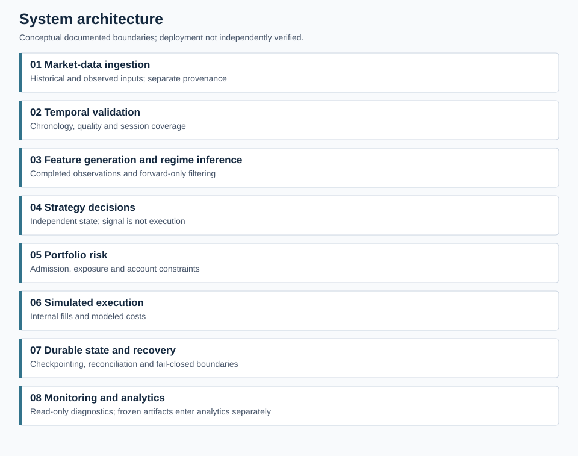

# Engineering architecture

The private project separates research artifacts from causal forward inference and simulated execution. The following descriptions are based on committed documentation; deployment identity was not inspected.

| Layer | Responsibility | Failure boundary |
|---|---|---|
| Data | Chronological observations, provenance, quality and session coverage | Missing observations do not prove exchange closure |
| Inference | Causal feature construction and forward regime filtering | Training must precede activation; frozen decoding is separate |
| Strategy | Independent decision state | Signals are distinct from admitted executions |
| Portfolio | Exposure and account-level risk constraints | Rejected decisions are not fills |
| Execution | Internal simulation and modeled costs | No real broker order submission claimed |
| Persistence | Durable delivery, checkpoints and reconciliation | Incompatible or corrupted state must fail closed |
| Observability | Read-only analytics and health diagnostics | Connectivity alone does not establish data freshness |

Raw HMM component labels are not necessarily economically stable across refits. Forward-only filtering is distinct from retrospective decoding. Historical replay parity does not prove causal parity. Historical engineering test reports exist, but this public repository does not rerun the private suite.

The public project contains no private deployment instructions, network endpoints, identifiers, credentials or production code. No dashboard screenshot was supplied for a sanitized release; none is fabricated.

The diagram describes documented functional boundaries, not verified deployment. Historical artifacts feed analytics separately from the simulated forward path.
