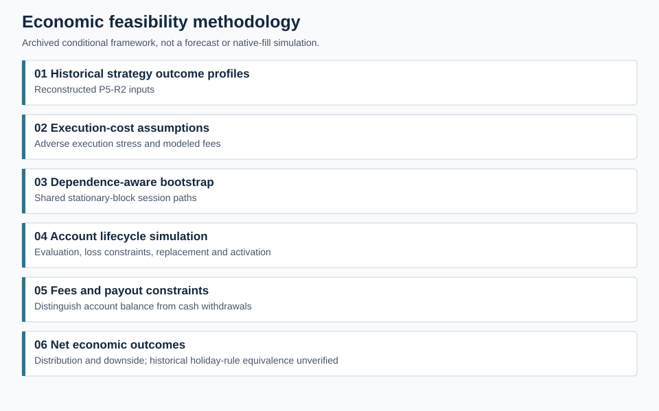

# Economic feasibility under execution and funding constraints

**Research question:** Can a systematic trading portfolio generate sufficiently reliable net income under realistic execution costs, funding constraints and adverse market conditions?

## Experimental design

The archived private study transforms reconstructed P5-R2 session profiles into conditional account outcomes. It uses stationary-block bootstrap resampling: contiguous historical blocks retain some serial dependence; block boundaries disrupt longer dependence. Shared market paths permit paired policy comparisons rather than comparing unrelated random draws. This is not native execution data.

A broad validation stage used **20,000 paths and 16 locked policy configurations** after an earlier selection stage. These are distinct from subsequent screening or selection experiments. More paths reduce simulation sampling noise conditional on the source and model; they do not create new independent market observations or remove historical selection bias. The public release does not contain path tapes or policy-level estimates, so this study is not independently rerun here.

## From strategy returns to economic outcomes

| Component | Interpretation |
|---|---|
| Historical session profiles | Risk and sizing assumptions are conditional; native fills are absent |
| Execution costs | One archived matched comparison reports a 17.9% net P&L decline under one adverse tick per side; not a universal estimate |
| Account lifecycle | Simulated evaluation, loss limits, failure, replacement and activation |
| Cash ledger | Fees, withdrawals and payout constraints separate account balance from spendable income |
| Income variability | Distribution of outcomes, downside, time to recovery and uncertainty matter more than a single expected value |
| Multi-account dependence | Shared strategies and market paths do not establish independent income streams |

The intended net economic measure is ending economic wealth less starting budget, with fees and eligible net cash payouts accounted for once. This describes the research objective, not an independently certified ledger implementation. Simulation uncertainty is separate from structural uncertainty about execution, market regimes, rule changes and administrative settlement.

## Mandatory session-close modeling gate

The November 25 hash/accounting audit reports material late exposure in the original P5-R2 reference (879 one-minute exposure marks across 70 dates and 114 exits after the ordinary cutoff). An initial cutoff overlay failed because shortened sessions and absent near-cutoff quotes were not handled correctly. The later date-aware v4 overlay used documented 2026 holiday cutoffs and a conditional current-rule analogue for 2021–2025. The archived session-compliance report labels all six one-tick stressed profiles **CONDITIONAL_PASS** at the structural boundary. This is progress, but not historical rule certification: exact 2021–2025 cutoffs and native fill equivalence remain unverified. The source reports a 17.86% P&L decline in one matched v4 stress, rounded to 17.9% elsewhere. No rejected prototype economics are included here.

The original trading reference is not a funded-account compliant ledger. Independent review of the underlying intraday records, dated rules, forced fills and cash-ledger reconciliation is unavailable in the public release. No decision-grade account economics or current eligibility is certified. See the [portfolio evolution](portfolio_evolution.md) for the original trading reference.

## Conclusion

**The available archived research does not support committing real money.** This is not proof that the underlying strategy is unprofitable. It reflects limitations of reconstructed evidence and modeled economic outcomes. No sustainable living-income, funded qualification or eligibility claim follows. Personal plans, account-specific parameters and funding-policy rankings are excluded.
