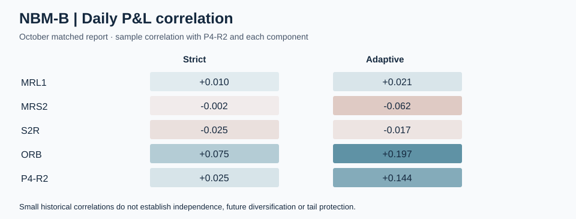
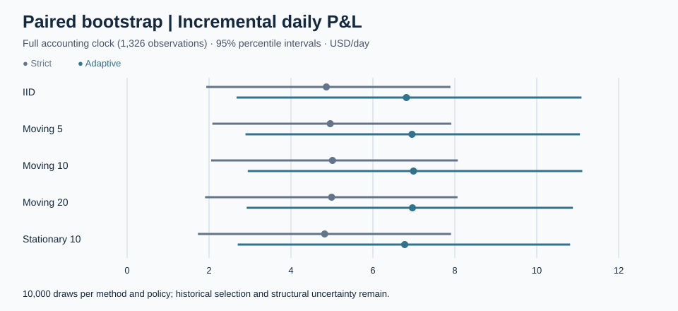
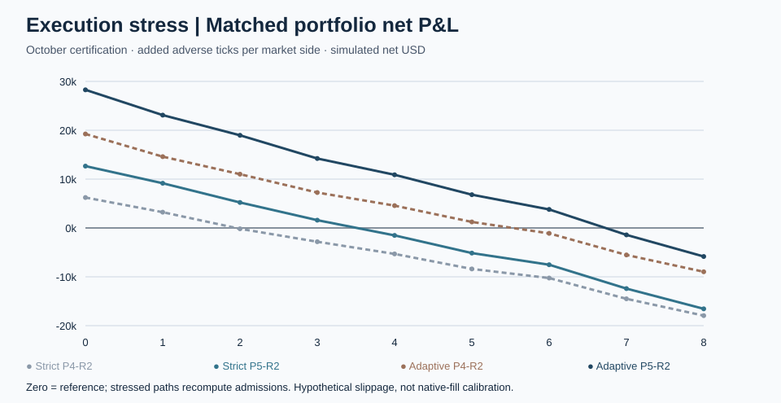

# NBM-B | Noise-band momentum research

## Motivation and literature

The research question is whether an intraday momentum component can add incremental value to an existing mean-reversion, regime and breakout portfolio. The literature motivates a time-dependent estimate of normal intraday price variation: movement beyond a typical range may indicate persistent flow, rather than a purely transitory fluctuation. That is a testable hypothesis, not a causal proof of the underlying mechanism.

A working paper retained in the project research library is Justin Chuk (October 2026), *Noise-Band Intraday Momentum in Nasdaq-100 Futures*, SSRN working paper 7609644. It discusses a futures adaptation of the SPY noise-band literature, execution frictions, in-sample strategy selection and explicit forward-test requirements. The source itself warns that the rule was selected from a larger tested family and had not traded live contracts. The paper's results are the author's, not DÉDALO I's. Exact specification equivalence and the full project-specific parameter-selection history have not been independently established from the available certification report.

Related references listed in that working paper (bibliography transcribed from the supplied paper; final publication metadata not independently checked here):

- Gao, L., Han, Y., Li, S. Z., and Zhou, G. (2018). *Market intraday momentum*. Journal of Financial Economics, 129(2), 394–414.
- Baltussen, G., Da, Z., Lammers, S., and Martens, M. (2021). *Hedging demand and market intraday momentum*. Journal of Financial Economics, 142(1), 377–403.
- Zarattini, C., Aziz, A., and Barbon, A. (2024). *Beat the market: an effective intraday momentum strategy for S&P 500 ETF (SPY)*. SSRN working paper, as cited by Chuk.

No third-party paper is redistributed in this repository. Proprietary thresholds, position-sizing logic, detailed entry/exit rules and implementation code are withheld.

## Historical contribution and diversification

The October 28, 2026 final historical certification reports that the frozen standalone NBM-B source recovered 862 trades and $11,511.50. These are source-control figures; they are not the incremental portfolio result. The matched P4-R2/P5-R2 comparison allows simultaneous ownership and admission constraints to change the accepted set of trades. The reported daily P&L correlation between NBM-B and P4-R2 is 0.025 under strict research sizing and 0.144 under adaptive research sizing. Correlations are sample- and policy-dependent; they do not establish independent losses or future diversification.

## Paired uncertainty

The report applies five fixed paired resampling methods (IID, moving blocks of 5/10/20 observations and stationary bootstrap with mean block 10), 10,000 draws each, on each of two research sizing conventions and two denominators. It also reports 10,000 paired IID and 10,000 paired moving-10 Monte Carlo paths per policy. P4/P5 observations remain paired. These are resamples of a historically selected reference, not untouched prospective validation.

| Policy | Method (full accounting clock) | Mean increment USD/day | 95% percentile interval USD/day |
|---|---|---:|---:|
| Strict | IID | 4.8644 | [1.9321, 7.8918] |
| Strict | Moving 5 | 4.9589 | [2.0807, 7.9126] |
| Strict | Moving 10 | 5.0134 | [2.0515, 8.0717] |
| Strict | Moving 20 | 4.9922 | [1.9027, 8.0656] |
| Strict | Stationary 10 | 4.8217 | [1.7274, 7.9073] |
| Adaptive | IID | 6.8181 | [2.6719, 11.0924] |
| Adaptive | Moving 5 | 6.9548 | [2.8894, 11.0543] |
| Adaptive | Moving 10 | 6.9909 | [2.9461, 11.1119] |
| Adaptive | Moving 20 | 6.9652 | [2.9187, 10.8814] |
| Adaptive | Stationary 10 | 6.7770 | [2.7000, 10.8153] |

All ten displayed percentile intervals exclude zero within the archived research assumptions. The source also reports a separate 963-entry-date denominator with positive intervals; the full accounting clock has 1,326 observations, including the exit-only tail. The two denominators must not be interchanged. Historical selection, multiple testing, changing market regimes and execution uncertainty are not removed by resampling.

## Execution sensitivity and negative findings

The source reports 64 completed portfolio stress cases spanning adverse market-side slippage, additional stop gaps, additional round-trip fees and entry delays. Each case recomputes historical decision/admission paths rather than simply subtracting fees from a fixed ledger. The following plot transcribes the strict/adaptive matched slippage scenarios, including the no-added-stress reference.

Both portfolios turn negative under sufficiently adverse slippage. Strict P5-R2 is negative at four added ticks per market side; adaptive P5-R2 is negative at seven. Under some scenarios the incremental drawdown deteriorates despite higher cumulative P&L. Stress magnitudes are hypothetical and are not measured native-fill distributions. The standalone NBM-B parameter grid and complete selection receipts are not available for independent review.

## Causal and engineering validation

The final certification reports 112 tests passed, none skipped, and static parsing of 49 research code/test files. It reports repeat primary replay equality across trades, opportunities, daily equity, lifecycle, availability and telemetry, with separate lifecycle and source-price audits. It also describes correction of historical retrospective model decoding and validation-window leakage in the revised MR/S2 research, and reports 38 newly fitted artifacts with strictly prior training and forward filtering. These are reported historical checks for the revised portfolio; they are not the current public test suite or proof of complete private production parity.

The final historical classification is **INTEGRATION_BLOCKED**. No PAPER deployment was authorized by that certification. To establish the next evidence level, the project would need versioned selection receipts, complete source data and model lineage, independent end-to-end reproduction, native execution equivalence and separate forward observations. No strategy implementation or trade-level data are supplied here.

Sources: October 28, 2026 *DÉDALO I — P5 final historical certification* (private report, aggregate transcription); Chuk working paper described above. See [portfolio comparison](portfolio_evolution.md), [reproducibility](reproducibility.md) and [limitations](limitations.md).
