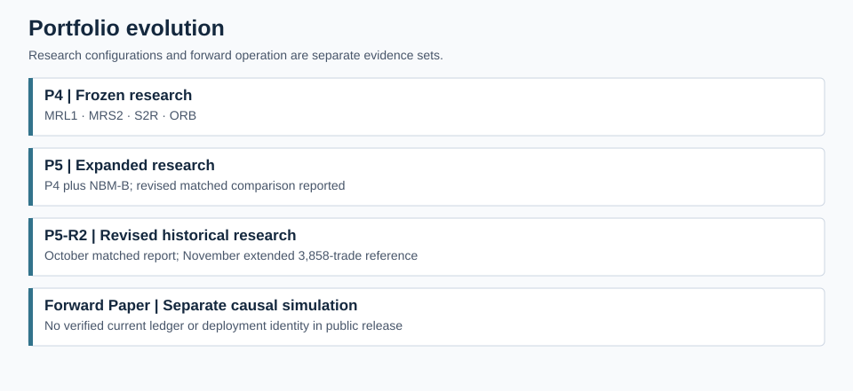
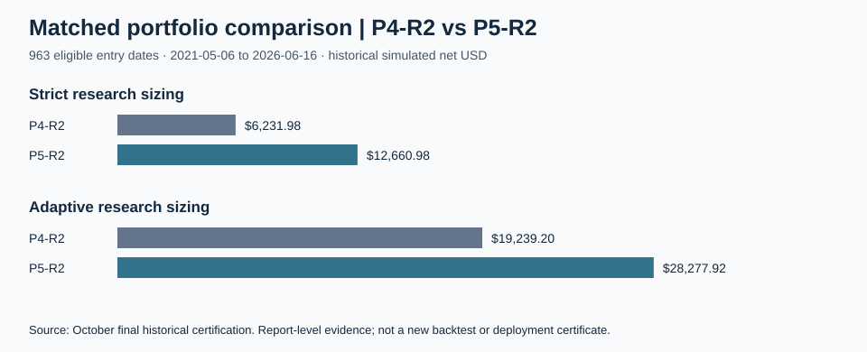
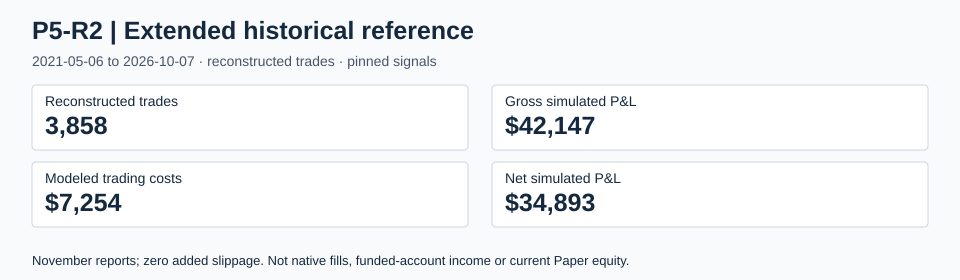

# Portfolio evolution and matched P5-R2 research

## Versions and research boundaries

P4 is the original frozen four-strategy research portfolio (MRL1, MRS2, S2R and ORB). P5 adds NBM-B, a noise-band intraday momentum component. The October 28, 2026 final historical certification compares **P4-R2 with P5-R2**: both use the revised causal research conventions, including a causal next-open ORB revision. P5-R2 adds the frozen NBM-B component to that revised baseline. The labels P4/P5 in the source report's performance tables refer to these R2 counterparts, not the original 3,255-trade frozen P4 tape.

The November 24 extended P5-R2 historical reference is a distinct, later research export. Its replay consumes pinned prior causal signals. Forward Paper is a separate operational simulation; native P5 equivalence and the current deployment identity have not been established. Neither historical reference constitutes live performance.

## October 28 historical certification

Primary comparisons restrict entries to the same 963 prespecified eligible dates, 2021-05-06 to 2026-06-16. The shared chronological accounting clock includes 1,326 observations through 2026-06-22, including an exit-only tail. The source uses fixed-risk budgets rather than compounding; two research sizing conventions are labeled strict and adaptive here. Dollar results are historical simulated trading P&L, not R or personal income. Specific production parameters are withheld.

| Matched research policy | Portfolio | Trades | Net USD | PF | Win % | Daily P&L Sharpe (252) | Sortino (252) | Minute-close max DD USD |
|---|---|---:|---:|---:|---:|---:|---:|---:|
| Strict | P4-R2 | 1,512 | 6,231.98 | 1.093 | 49.27 | 0.663 | 1.076 | −2,962.90 |
| Strict | P5-R2 | 2,278 | 12,660.98 | 1.140 | 51.80 | 1.194 | 1.994 | −2,079.27 |
| Adaptive | P4-R2 | 2,061 | 19,239.20 | 1.164 | 49.54 | 1.206 | 1.999 | −4,924.12 |
| Adaptive | P5-R2 | 2,917 | 28,277.92 | 1.189 | 51.87 | 1.560 | 2.684 | −4,836.62 |

The matched incremental net P&L is +$6,429.00 (+103.16%) in the strict comparison and +$9,038.72 (+46.98%) in the adaptive comparison. The adaptive Sharpe increases by 0.354 using the rounded table values (the report's unrounded difference is 0.355). The strict drawdown magnitude falls by $883.63 and adaptive by $87.50. These are path-specific historical differences, not isolated additive NBM-B profits: adding the fifth strategy changes admission and displacement.

### Secondary continuous diagnostics

The following full-available runs are secondary, not replacements for the prespecified matched-date comparisons. The report does not assign them a common eligible-entry denominator.

| Research policy | Portfolio | Trades | Net USD | PF | Win % | Daily P&L Sharpe (252) | Minute-close max DD USD |
|---|---|---:|---:|---:|---:|---:|---:|
| Strict | P4-R2 | 2,086 | 13,870.10 | 1.153 | 50.38 | 1.265 | −2,408.14 |
| Strict | P5-R2 | 2,852 | 20,299.10 | 1.177 | 52.10 | 1.692 | −2,091.03 |
| Adaptive | P4-R2 | 2,819 | 28,666.84 | 1.181 | 50.16 | 1.565 | −3,835.21 |
| Adaptive | P5-R2 | 3,675 | 37,705.56 | 1.198 | 51.86 | 1.865 | −4,155.98 |

In the continuous adaptive diagnostic, P5-R2 has higher P&L but also a worse minute-close drawdown. The historical evidence therefore does not justify a blanket drawdown-reduction claim.

## Extended November historical reference

The November 24 final report and November 25 accounting audit describe the following later five-strategy P5-R2 reference, 2021-05-06 through 2026-10-07. The profitability reconciliation explicitly separates trading P&L from economic wealth.

| Metric | Archived reference |
|---|---:|
| Reconstructed trades | 3,858 |
| Rejected opportunities | 8,565 |
| Gross simulated P&L | $42,147 |
| Modeled trading costs | $7,254 |
| Net simulated trading P&L | $34,893 |

This is a frozen, zero-added-slippage replay of pinned signals, with a stop-first minute-OHLC convention. It is not a new model refit, native broker execution, validated annual income, or an independently rerun portfolio here. Do not compare its P&L directly with the October matched results: evaluation dates, profiles and scope differ. The November hash audit reports exact downstream reproduction after correcting a model-receipt lineage identifier; 33 opportunity rows in one fold had a differing lineage hash. The non-redacted ancestor receipt was unavailable for independent rehashing. A separate account audit reports zero daily cash residual after correct commission allocation. Neither resolves native integration or mandatory funded-account close rules.

## Evidence gates

- Report-level matched comparison, marginal contribution, paired uncertainty, execution stress and selected engineering tests: recovered from the October certification report.
- Extended aggregate results and reported accounting reconciliation: recovered from the November reports.
- Underlying trade, model, opportunity and telemetry tapes; independent full refit/replay; current forward deployment identity: not available for public reproduction.
- Historical trading research remains distinct from conditional funded-account economics. Native integration classification in the October report: **INTEGRATION_BLOCKED**.

See [NBM-B research](nbm_research.md), [evidence index](research_evidence.md), [economic research](economic_research.md) and [limitations](limitations.md). All newly transcribed aggregates are proposed for author-approved public disclosure; the underlying private records remain excluded.
