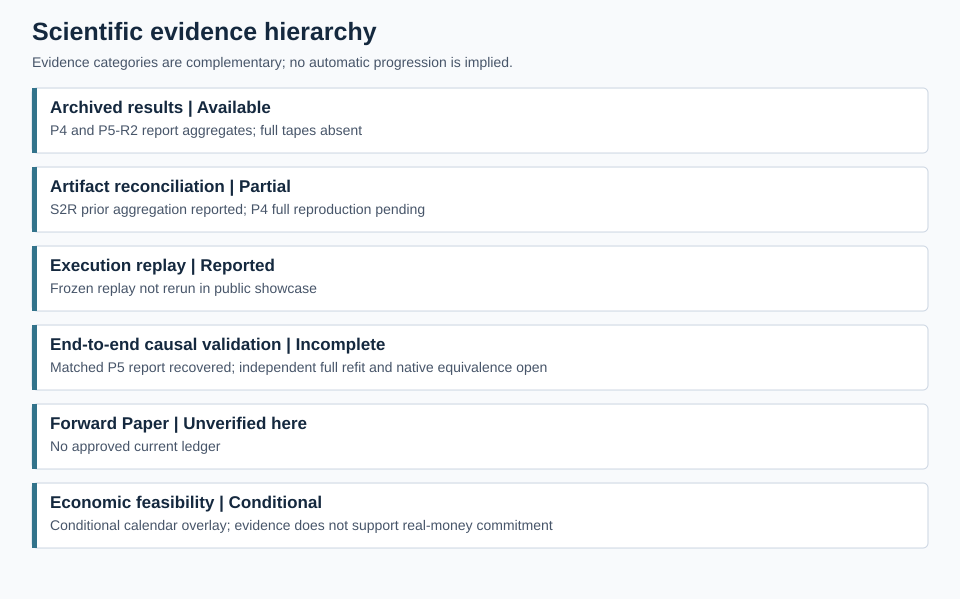

# Research evidence and interpretation

Public evidence baseline: 26 November 2026. Only aggregate findings are reproduced here; artifact descriptions identify evidence types, not public access to private records.

| Claim | Supporting artifact | Evaluation period | Version | Verification level | Publication status | Limitation |
|---|---|---|---|---|---|---|
| 3,255 trades; +289.661901R; PF 1.215771; expectancy 0.088990R; win rate 50.6605%; max DD −18.093472R | Archived frozen reproduction reference | 2020-06-23 to 2026-06-19 | P4 | Archived | Existing public aggregate | Full inputs absent |
| 520 of 537 outcomes; +26.932R; PF 1.116565; win rate 45.9615%; expectancy 0.051792R | Prior independent aggregation of stored net_R outcomes | Frozen P4 bounds | S2R | Artifact reconciliation reported | Existing public aggregate | No tape here; not signal or fill validation |
| −16.7936R drawdown | Prior S2R entry-ordered aggregation | Frozen P4 bounds | S2R | Artifact reconciliation reported | Existing public aggregate | Initial zero; not mark-to-market |
| 2,899 exact executions; 356 gated non-executions; no unexplained mismatches or extras reported | Archived frozen replay report | Frozen P4 research | P4 | Reported execution replay | Existing public aggregate | Not rerun; not causal parity |
| Matched net P&L: strict $6,231.98/$12,660.98; adaptive $19,239.20/$28,277.92 | October 28 P5 final historical certification | 963 eligible dates, 2021-05-06 to 2026-06-16 | P4-R2/P5-R2 | Report-level transcription | Proposed aggregate | No private tape rerun; integration blocked |
| 5 paired methods, 10,000 draws each; 64 stress cases; 112 tests passed | Same final certification | Matched historical research | P4-R2/P5-R2 | Reported historical diagnostics | Proposed aggregate | Not untouched OOS or public CI |
| 3,858 trades, $42,147 gross, $7,254 trading costs, $34,893 net | November 24 final report; November 25 hash/accounting audit; profitability reconciliation | 2021-05-06 to 2026-10-07 | Extended P5-R2 | Cross-report corroboration | Proposed aggregate | Pinned signals, not refit or native fills; ancestor receipt unavailable |
| Date-aware cutoff boundary checks passed conditionally across six stressed profiles | November 25 session-calendar audit and session-compliance summary | Extended historical reference period | Reconstructed P5-R2 overlay | Reported conditional replay | Proposed aggregate | 2021–2025 rules analogue, native fills not verified |
| 20,000 paths; 16 locked policies; 17.9% matched cost-stress decline (separate comparison) | Archived economic study summary | Dated research; exact tape period not published | Reconstructed P5-R2 | Reported conditional simulation | Existing public aggregate | Mandatory close, native fills and structural uncertainty unresolved |
| Separate forward simulated account | Architecture documentation | Latest ledger unavailable | Forward Paper | Descriptive | Existing public description | No performance or deployment certification |

Archived P4 strategy counts: MRL1 430, MRS2 863, S2R 520, ORB 1,442. Frequency is not profitability contribution. Counts and rounded expectancy are internally reconcilable, not independent backtest validation.

The public synthetic demo does not reproduce the private research. Entry-date aggregation is distinct from daily mark-to-market returns. See [reproducibility](reproducibility.md).
